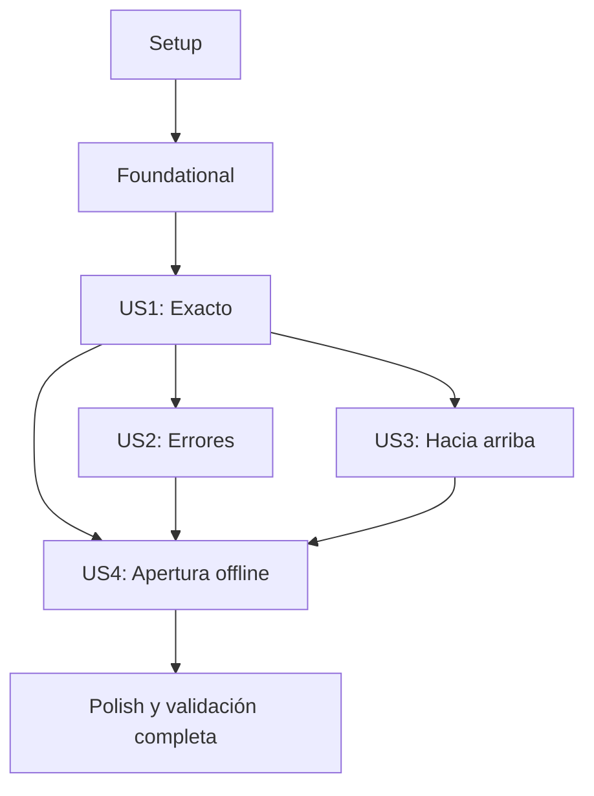

# Tasks: Dividir la cuenta de un restaurante

**Input**: Documentos de `specs/001-dividir-cuenta/`.
**Prerequisites**: [plan.md](plan.md), [spec.md](spec.md),
[research.md](research.md), [data-model.md](data-model.md),
[contratos](contracts/dominio-y-pantalla.md),
[aceptación](contracts/aceptacion.md) y [quickstart.md](quickstart.md).

**Tests**: Incluir pruebas ejecutables con Vitest, conforme a la Constitution y a la
instrucción del usuario. Preparar los casos antes de implementar el comportamiento
correspondiente y comprobarlos al terminar cada historia.

**Organization**: Cuatro historias, todas P1, en el orden de la spec.
Los checkboxes indican trabajo pendiente; este comando genera tareas, no implementa.

## Format: `[ID] [P?] [Story] Description`

- Cada tarea usa checkbox, identificador secuencial y rutas concretas.
- `[P]` permite trabajo paralelo en archivos diferentes, sólo cuando sus
  prerrequisitos estén completos y dentro de las olas descritas abajo.
- `[US1]` a `[US4]` identifican las historias de la spec.
- Setup, Foundational y Polish no llevan etiqueta de historia.

## Path Conventions

Las rutas de código y configuración son relativas a `divisor_cuenta_web/`.
Los documentos del feature están en `specs/001-dividir-cuenta/`.
Mantener intactas la spec y la Constitution. Usar React/Vite/JavaScript,
`useState` y el contrato único `aplicar(valor)`, sin bibliotecas de estado.

## Phase 1: Setup (Shared Infrastructure)

**Purpose**: Preparar el proyecto existente y las herramientas, sin volver a generar
la plantilla de Vite.

- [ ] T001 Comprobar Node.js 22.12+ y npm, conservar React/Vite existentes e instalar las dependencias de desarrollo vitest, jsdom y playwright más Chromium; fijar versiones compatibles en `package.json` y `package-lock.json`, sin agregar bibliotecas de estado.
- [ ] T002 Crear las carpetas previstas en `src/domain/`, `src/data/`, `src/presentation/`, `scripts/` y `tests/domain/`, `tests/data/`, `tests/presentation/`, `tests/acceptance/`, `tests/offline/`; conservar el punto de entrada `src/main.jsx`.
- [ ] T003 [P] Configurar `vitest.config.js` con el plugin React de `vite.config.js`, Node por defecto, jsdom por suite DOM y exclusión de `tests/offline/`; habilitar React act en `tests/setup.js`, sin otro runner.
- [ ] T004 [P] Ajustar `eslint.config.js` para JavaScript/JSX de navegador, herramientas Node y pruebas Vitest, conservando las reglas de hooks y excluyendo `dist/`.

**Checkpoint**: Dependencias y carpetas disponibles; configuración normal de Vitest
y lint preparada. Los scripts de npm se conectarán en T019 y T035.

## Phase 2: Foundational (Blocking Prerequisites)

**Purpose**: Definir los valores compartidos y la validación que todos los cálculos usan.
Completar esta fase antes de integrar una historia en la pantalla.

- [ ] T005 [P] Declarar con JSDoc en `src/domain/estrategiaRedondeo.js` ValorRacional y EstrategiaRedondeo: numerador bigint con «Mayor o igual que cero.», denominador bigint con «Mayor que cero.» y única función `aplicar(valor)` que devuelve centavos bigint; sin implementación concreta.
- [ ] T006 [P] Definir Cuenta y `crearCuenta(datosNormalizados)` en `src/domain/cuenta.js`: monto y porcentajePropina racionales con «Entrada numérica finita no negativa.», personas bigint con «Entero mayor o igual que uno.»; construir el valor sin validar, calcular ni formatear.
- [ ] T007 [P] Definir Resultado y `crearResultado(centavosPorPersona)` en `src/domain/resultado.js`, con centavosPorPersona bigint y significado «Importe individual después de aplicar la estrategia.»; sin error de entrada, reparto ni formato.
- [ ] T008 Crear `tests/domain/validarEntrada.test.js` para normalización exacta de textos decimales completos con punto, signo/exponente opcionales, vacío distinto de cero, 1.005, 1e309 y personas 9007199254740993; comprobar Cuenta y retorno válido/invalidación sin excepciones de usuario.
- [ ] T009 Implementar `validarEntrada(entrada)` y sus helpers en `src/domain/validarEntrada.js`, según T005/T006 y `data-model.md`: conservar los textos como racionales BigInt sin Number ni parseFloat, rechazar vacío/NaN/Infinity/no numérico/negativo, exigir personas enteras positivas, devolver `{ valido: true, cuenta }` o `{ valido: false, error: { campo, mensaje } }` y respetar «No hay máximo arbitrario ni límite de dos decimales en las entradas.».

T009 utiliza el orden monto → personas → propina del diseño. Para personas numéricas
no positivas, comprobar esa condición antes de integralidad. Los mensajes son
«Monto inválido» y «Debe haber al menos una persona» en los casos fijados;
«Número de personas inválido» y «Propina inválida» en los restantes casos del modelo.
La cobertura detallada de errores y de su visualización se completa en US2.

**Checkpoint**: T005–T009 completos y pruebas de normalización pasando.
Domain contiene sólo JavaScript puro y no importa React, DOM ni data.

## Phase 3: User Story 1 - Calcular el pago de cada persona (Priority: P1) — MVP

**Goal**: Ingresar monto, personas y propina, calcular en Exacto y mostrar cuánto
paga cada persona con dos decimales en la única pantalla.

**Independent Test**: Ejecutar CA-001 → 27.50, CA-002 → 30.00 y CA-005 → 3.33;
verificar ausencia inicial de resultado y cálculo sólo al enviar.

### Tests for User Story 1

- [ ] T010 [P] [US1] Crear `tests/data/redondeoExacto.test.js` para `aplicar(valor)`: retorno bigint, 10/3 → 333n, cero, empate 1.005 → 101n y 2.675 → 268n, sin mutación ni validación del formulario.
- [ ] T011 [P] [US1] Crear `tests/domain/calcularDivision.test.js` con dobles del contrato abstracto para fórmula monto × (1 + propina/100) / personas y una llamada a aplicar; verificar 0.02/2 con 49% → 0.01 sin redondear antes el total, usando el algoritmo real en aceptación.
- [ ] T012 [P] [US1] Crear `tests/presentation/formateadorMoneda.test.js` para centavos 0n, 333n, 2750n y 400n → 0.00, 3.33, 27.50 y 4.00, así como cantidades grandes y 10^309 con .00 sin notación exponencial ni redondeo nuevo.
- [ ] T013 [P] [US1] Crear `tests/acceptance/calculoExacto.test.jsx` con jsdom y act montando/desmontando la composición real de `src/main.jsx`; cubrir CA-001/CA-002/CA-005, pantalla inicial sin resultado, edición sin recálculo, una persona, monto cero, empates, propina decimal y números grandes de `contracts/aceptacion.md`.

### Implementation for User Story 1

- [ ] T014 [P] [US1] Implementar `src/data/redondeoExacto.js` con exports id=exacto, etiqueta=Exacto y aplicar anotada con el contrato de domain; redondear 100N/D por cociente/resto, sumar un centavo si 2r >= D, devolver bigint y no crear un objeto de estrategia en el módulo.
- [ ] T015 [P] [US1] Implementar `calcularDivision(cuenta, estrategia)` en `src/domain/calcularDivision.js`: para monto A/Da, propina T/Dt y personas P, construir N=A×(100×Dt+T), D=Da×100×Dt×P, llamar aplicar una vez y devolver crearResultado; sin validar, formatear, importar data o consultar tipos/modos.
- [ ] T016 [P] [US1] Implementar `src/presentation/formateadorMoneda.js` separando centavos bigint en entero/resto y completando dos cifras con punto; no usar el formato como algoritmo de redondeo.
- [ ] T017 [US1] Implementar `useDivisor(catalogo, modoInicialId)` en `src/presentation/useDivisor.js` con useState para entradas textuales, modo y salida; defaults monto/personas vacíos y propina 0, «Resultado y error null.» al iniciar, validar antes de calcular y usar los valores actuales sólo al enviar.
- [ ] T018 [US1] Implementar `src/presentation/PantallaDivisor.jsx` con tres entradas de texto e inputMode, etiquetas, selector derivado del catálogo, botón Calcular y resultado «Por persona: importe»; recibir modoInicialId por props y evitar validación nativa que bloquee los mensajes definidos.
- [ ] T019 [P] [US1] Componer y montar la pantalla en `src/main.jsx` mediante import.meta.glob de ./data/redondeo*.js con eager: true; crear sólo aquí objetos { aplicar }, ordenar catálogo por id «string único», detectar id duplicado/aplicar ausente e inyectar modoInicialId=exacto sin codificarlo en el hook; ofrecer montaje/desmontaje a aceptación y conectar test/test:watch en `package.json`.
- [ ] T020 [P] [US1] Preparar los estilos de la única pantalla en `src/index.css` y la entrada/title locales en `index.html`; sustituir la pantalla inicial del ejemplo de Vite, sin fuentes ni recursos remotos.
- [ ] T021 [US1] Ejecutar con Vitest las suites `tests/domain/validarEntrada.test.js`, `tests/domain/calcularDivision.test.js`, `tests/data/redondeoExacto.test.js`, `tests/presentation/formateadorMoneda.test.js` y `tests/acceptance/calculoExacto.test.jsx`; corregir fallos y comprobar CA-001/002/005, precisión y estado inicial antes de cerrar US1.

**Checkpoint**: Incremento Exacto demostrable y pruebas de US1 pasando.
No es la entrega completa: faltan la validación visual de US2, Hacia arriba y apertura offline.

## Phase 4: User Story 2 - Identificar entradas inválidas (Priority: P1)

**Goal**: Mostrar errores de entrada, ocultar cualquier resultado y permitir corregir
los datos sin salir de la pantalla.

**Independent Test**: CA-003 y CA-004 antes y después de CA-001 muestran el mensaje
exacto y ningún resultado. Corregir los datos y enviar de nuevo produce un resultado.

### Tests for User Story 2

- [ ] T022 [P] [US2] Crear `tests/domain/validacionErrores.test.js` para monto vacío/abc/NaN/Infinity/negativo, personas vacías/abc/Infinity/1.5/0/-1/-0.5 y propina vacía/abc/NaN/Infinity/negativa; verificar mensajes, campo, orden monto → personas → propina y ausencia de excepciones.
- [ ] T023 [P] [US2] Crear `tests/presentation/useDivisor.test.jsx` con React act para validación antes del cálculo, no calcular ante error, exclusión mutua de resultado/error, borrado tras válido → inválido y recuperación tras corrección; usar contratos abstractos y no instanciar estrategias de data fuera de main.
- [ ] T024 [P] [US2] Crear `tests/acceptance/erroresEntrada.test.jsx` montando `src/main.jsx` para CA-003 «Debe haber al menos una persona» y CA-004 «Monto inválido», en inicio y tras CA-001; cubrir restantes entradas inválidas y corrección con nuevo envío en la misma pantalla.

### Implementation for User Story 2

- [ ] T025 [US2] Completar la integración de errores en `src/presentation/useDivisor.js` y `src/presentation/PantallaDivisor.jsx`: «Resultado null y error del validador, aunque existía un resultado anterior.» ante inválido, resultado nuevo/error null ante válido, mostrar mensaje y eliminar el elemento de resultado; usar las reglas de `src/domain/validarEntrada.js` sin duplicarlas en UI.
- [ ] T026 [US2] Ejecutar `tests/domain/validacionErrores.test.js`, `tests/presentation/useDivisor.test.jsx` y `tests/acceptance/erroresEntrada.test.jsx`, junto con la aceptación US1; corregir fallos y verificar FR-008 a FR-011 y SC-003/SC-005.

**Checkpoint**: Mensajes, limpieza del resultado y recuperación verificados.
Los textos exactos no se cambian; los demás errores siguen las decisiones del modelo.

## Phase 5: User Story 3 - Elegir el redondeo hacia arriba (Priority: P1)

**Goal**: Seleccionar Hacia arriba para obtener el menor entero igual o mayor que
el cociente original, mostrado con dos decimales.

**Independent Test**: CA-006 → 4.00; Exacto → Hacia arriba → Exacto, cada uno con
nuevo clic, muestra 3.33 → 4.00 → 3.33.

### Tests for User Story 3

- [ ] T027 [P] [US3] Crear `tests/data/redondeoHaciaArriba.test.js` para contrato aplicar: 10/3 → 400n, 90/3 → 3000n, 3.0001 → 400n y cero → 0n; verificar bigint, mismas precondiciones que Exacto y ausencia de mutación.
- [ ] T028 [P] [US3] Crear `tests/acceptance/redondeoHaciaArriba.test.jsx` montando `src/main.jsx`: CA-006, entero sin aumento, cero, una persona, cociente original y cambio Exacto → Hacia arriba → Exacto sólo al enviar; comprobar selección visible desde catálogo y .00.

### Implementation for User Story 3

- [ ] T029 [US3] Implementar `src/data/redondeoHaciaArriba.js` con exports id=hacia-arriba, etiqueta=Hacia arriba y aplicar: techo exacto de N/D por cociente/resto multiplicado por 100, sin redondeo previo ni instancia de estrategia; su incorporación debe funcionar sin editar `src/main.jsx`, `src/domain/calcularDivision.js` ni `src/presentation/`.
- [ ] T030 [US3] Ejecutar `tests/data/redondeoHaciaArriba.test.js` y `tests/acceptance/redondeoHaciaArriba.test.jsx`, junto con aceptación US1/US2; confirmar CA-006, SC-002 y sustitución por el contrato sin ramas por tipo.

**Checkpoint**: Ambos modos funcionan con el mismo cálculo y pantalla.
La incorporación de la segunda estrategia demuestra la extensión por módulo compatible.

## Phase 6: User Story 4 - Dividir la cuenta sin conexión (Priority: P1)

**Goal**: Abrir de nuevo la aplicación preparada y completar los seis escenarios
sin conexión, sin servicios ni persistencia de cuentas.

**Independent Test**: Preparar el build, el registro activo del worker y la caché en
localhost:4173 antes de la verificación offline. Cerrar la página, activar offline
en el mismo contexto e iniciar la observación antes de abrir otra página.
Abrir o reabrir la aplicación, editar las entradas, validar y calcular sin conexión;
repetir CA-001 a CA-006 con los mismos resultados y mensajes. Comprobar cero tráfico
de red real durante todas esas acciones, incluido el mismo origen y el worker.

### Tests for User Story 4

- [ ] T031 [P] [US4] Crear `tests/offline/reapertura.test.js` con Vitest en Node y playwright como biblioteca: preparar build/caché y verificar registro activo/control según T034 antes de la medición; cerrar página, activar setOffline(true) e iniciar la observación del contexto completo y del worker antes de abrir otra en el mismo origen; cubrir apertura/reapertura, edición de entradas, validación y cálculo offline, repetir CA-001 a CA-006, errores tras válido y cambios de modo; comprobar HTML/JS/CSS desde caché del worker, salida inicial vacía y cero tráfico de red real durante todas esas acciones, al mismo origen y a destinos externos, distinguiéndolo de solicitudes lógicas atendidas localmente.
- [ ] T032 [P] [US4] Configurar `vitest.offline.config.js` para incluir únicamente `tests/offline/`, usar Node y Chromium preparado en T001, sin @playwright/test ni simulación de navigator.onLine; usar http://localhost:4173 y cierre de páginas/contextos al finalizar.

### Implementation for User Story 4

- [ ] T033 [US4] Implementar `scripts/generarCacheOffline.js` como post-build: enumerar index.html/JS/CSS/activos locales reales de `dist/`, excluir el propio sw.js, calcular huella del build y generar `dist/sw.js` con rutas relativas al ámbito, precarga completa antes de activar, cachés propias y respuesta de navegación raíz mediante index.html almacenado; guardar sólo recursos estáticos.
- [ ] T034 [US4] Añadir en `src/main.jsx` el registro del worker generado sólo en producción, con URL/ámbito de la distribución; verificar en `tests/offline/reapertura.test.js`, durante la preparación previa a la medición, que getRegistration devuelve el registro esperado, que scope y scriptURL corresponden a la distribución, que el worker está activated y que navigator.serviceWorker.controller controla la página con ese worker; al reabrir offline, comprobar registro activo y control conservados, sin depender de conexión para abrir/editar/validar/calcular ni producir tráfico real de registro o actualización durante la ventana observada; comprobar que en desarrollo no se intenta registrar y conservar main como único punto de conexión, sin modificar domain ni presentation para este soporte.
- [ ] T035 [US4] Conectar en `package.json` build = Vite build + `scripts/generarCacheOffline.js` y test:offline = Vitest con `vitest.offline.config.js`; conservar dev/preview/lint y el lockfile, sin añadir backend, plugin PWA ni biblioteca de estado.
- [ ] T036 [US4] Ejecutar build y verificar `dist/index.html`, `dist/assets/` y `dist/sw.js`, lista completa de recursos y caché sin entradas/resultados; servir mediante npm run preview -- --host localhost --port 4173 --strictPort conforme a `specs/001-dividir-cuenta/quickstart.md`.
- [ ] T037 [US4] Ejecutar npm run test:offline con `tests/offline/reapertura.test.js`, corregir fallos y verificar FR-012/SC-004: apertura/reapertura, edición de entradas, validación y cálculo sin conexión, seis CA con los mismos resultados y mensajes y cero tráfico de red real durante toda la ventana observada, incluido el registro del worker; comprobar respuestas desde caché y no depender de una página ya cargada ni confundir solicitudes locales con tráfico de red.

**Checkpoint**: Apertura/reapertura, edición, validación y cálculo offline verificados,
con los seis CA correctos y sin tráfico de red real durante esas acciones.
La preparación del registro y la precarga terminan antes de iniciar la medición.
Observar las solicitudes de la página y las del worker: una respuesta marcada como
servida por el worker no demuestra por sí sola que vino de caché, porque el worker
puede reenviar una petición a la red. Verificar el origen local de los recursos y la
ausencia de accesos efectivos al servidor u otros destinos; no contar las solicitudes
lógicas resueltas desde caché como tráfico real. Referencia de verificación:
[Playwright: eventos de red y service workers](https://playwright.dev/docs/service-workers#network-events-and-routing).
La precarga es preparación de la entrega, separada del uso del formulario.
No se promete descargar una URL remota nunca instalada con el dispositivo desconectado.

## Phase 7: Polish & Cross-Cutting Concerns

**Purpose**: Completar la revisión de los cinco principios y validar la entrega conjunta.

- [ ] T038 Revisar imports y responsabilidades en `src/domain/`, `src/data/`, `src/presentation/` y `src/main.jsx`: domain puro sin React/DOM/data, presentation sin data, cálculo sin validación/formato, objetos concretos sólo en main y consumidores usando aplicar sin consultar tipos.
- [ ] T039 Completar la explicación de cada función generada en `src/domain/`, `src/data/`, `src/presentation/`, `src/main.jsx`, `scripts/generarCacheOffline.js` y `tests/`: qué hace, por qué existe, qué recibe, qué devuelve y qué errores produce; incluir helpers, handlers y funciones del worker generado.
- [ ] T040 Revisar `src/`, `scripts/`, `tests/`, `package.json` y `.gitignore` para cumplir «Nunca se guardan secretos ni API keys en el repositorio.»; confirmar que esta funcionalidad no introduce credenciales ni almacena cuentas.
- [ ] T041 Actualizar `README.md` y `specs/001-dividir-cuenta/quickstart.md` con los comandos realmente disponibles, estructura, prerrequisitos y preparación offline; conservar `specs/001-dividir-cuenta/spec.md` y `.specify/memory/constitution.md` intactos.
- [ ] T042 Ejecutar npm test, npm run lint, npm run build y la validación offline con preview, verificar todos los casos de `specs/001-dividir-cuenta/contracts/aceptacion.md` y registrar resultados reales en `specs/001-dividir-cuenta/quickstart.md`; sólo marcar completas las tareas verificadas en `specs/001-dividir-cuenta/tasks.md`.

**Checkpoint**: FR-001 a FR-012 y SC-001 a SC-005 verificados; las cuatro historias
completas y cada función explicable según la Constitution.

## Dependencies & Execution Order

### Phase Dependencies

1. Setup: T001/T002 antes de T003/T004.
2. Foundational: T005/T006/T007 en paralelo; T008 antes de T009,
   que utiliza los contratos y Cuenta ya definidos.
3. US1: después de T005–T009; completar sus pruebas antes de la implementación
   correspondiente, luego integrar hook/pantalla/main y validar.
4. US2: necesita la pantalla y cálculo US1 para verificar válido → inválido → corregido.
5. US3: contrato y estrategia se pueden preparar tras Foundational; aceptación requiere
   la composición US1. Integrar y validar en el orden mostrado para conservar US2.
6. US4: preparación de soporte independiente; aceptación final requiere US1, US2 y US3.
7. Polish: después de las cuatro historias; validación conjunta al final.

### User Story Dependencies

US2 y US3 se verifican por sus propias suites sobre el incremento US1.
La prueba independiente de US4 integra necesariamente los seis CA.
Todas las historias mantienen P1; el orden anterior responde a dependencias técnicas.

### Within Each User Story

- Casos ejecutables antes del comportamiento correspondiente; correrlos al integrar.
- Valores y contrato antes de estrategias y cálculo; lógica antes de composición.
- Pruebas de aceptación mediante main, sin crear estrategias concretas en tests.
- En T011 se permiten dobles del contrato abstracto para observar la llamada;
  no son instancias de implementaciones de data.
- Cada historia termina con su validación; los cambios de fases posteriores
  también deben conservar las aceptaciones anteriores.

### Parallel Opportunities

- Tras T001/T002: T003 y T004.
- Tras Setup: T005, T006 y T007; preparar T008 mientras se terminan esos archivos,
  pero T009 espera T005/T006 y sus casos de prueba.
- US1: ola de pruebas T010/T011/T012/T013; después, T014/T015/T016
  en paralelo, cada una con su contrato, valores y casos ya preparados.
- T017 espera cálculo/redondeo; T018 espera el hook y formateador.
  Después de T018, T019 y T020 usan archivos diferentes.
- US2: T022/T023/T024 en paralelo; T025 integra después y T026 valida.
- US3: T027/T028 en paralelo; T029 después de sus casos y T030 valida.
- US4: T031/T032 en paralelo. T033 puede prepararse antes de las otras historias
  si tiene propietario exclusivo; T034 espera composición US1 y no comparte editor.
- Las modificaciones de main (T019/T034), package.json (T001/T019/T035),
  el hook y pantalla (T017/T018/T025) y quickstart (T041/T042) son secuenciales.

## Parallel Example: User Story 1

Después de Foundational, preparar en paralelo T010/T011/T012/T013, cada una en
su archivo de tests. Después de esa ola, ejecutar T014/T015/T016 simultáneamente:
redondeoExacto.js, calcularDivision.js y formateadorMoneda.js.

## Parallel Example: User Story 2

Preparar T022/T023/T024 simultáneamente en validacionErrores.test.js,
useDivisor.test.jsx y erroresEntrada.test.jsx. La integración compartida T025
y la comprobación T026 esperan esas tareas y US1.

## Parallel Example: User Story 3

Preparar T027 y T028 simultáneamente en redondeoHaciaArriba.test.js y
redondeoHaciaArriba.test.jsx. T029 crea sólo la estrategia nueva; no se reparte
la edición de main o del selector para incorporar este modo.

## Parallel Example: User Story 4

Preparar T031 y T032 simultáneamente en reapertura.test.js y vitest.offline.config.js.
T033 puede desarrollarse por separado mientras otro responsable completa US1–US3.
El registro T034 y scripts T035 se integran después; T037 espera el build preparado.

## Implementation Strategy

### MVP First (User Story 1 Only)

Completar Setup, Foundational y US1 (T001–T021). Validar los tres CA en Exacto,
precisión, presentación y ausencia inicial de resultado.
Ese incremento sirve para demostrar el cálculo; la entrega del feature requiere
también US2, US3 y US4.

### Incremental Delivery

1. US1: cálculo Exacto y pantalla.
2. US2: errores y recuperación verificados.
3. US3: segundo modo por extensión compatible.
4. US4: apertura desconectada con las seis aceptaciones.
5. Polish: revisión de principios y comprobación conjunta.

### Parallel Team Strategy

Distribuir archivos de pruebas y funciones puras según las olas anteriores.
Asignar un único responsable por cada integración que modifique main o package.json.
No ejecutar dos tareas a la vez cuando escriban el mismo archivo.

## Notes

- Este archivo contiene 42 tareas: 4 Setup, 5 Foundational, 12 US1,
  5 US2, 4 US3, 7 US4 y 5 Polish.
- Las restricciones citadas se conservan desde data-model.md y la Constitution.
- Las pruebas cubren los seis CA y todos los casos límite del contrato de aceptación.
- La generación no ejecuta instalaciones, cambia código ni produce resultados de tests.
